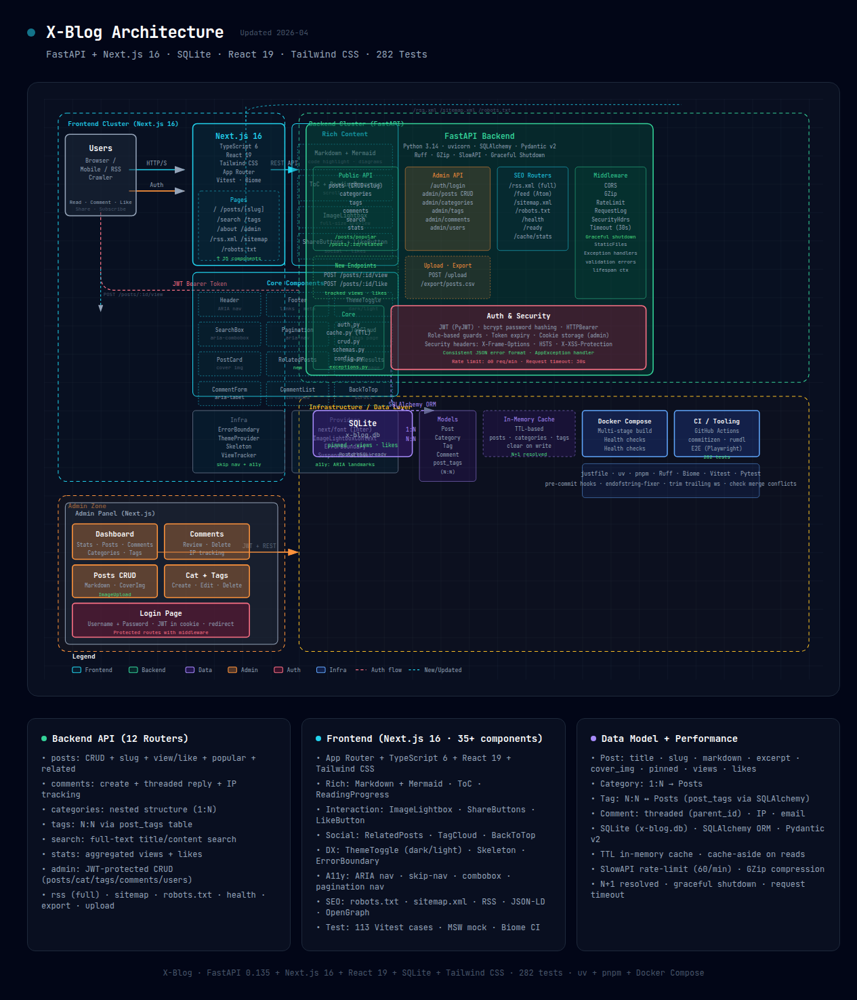

# X-Blog

<div align="center">


现代化的全栈博客引擎：**FastAPI + SQLAlchemy 2** 后端 + **Nuxt 4 + Vue** 前端，全程由 `just` 驱动。亮点：可安装的 PWA（支持离线阅读已收藏文章）、云端同步的读者数据、完整的通知体系，以及一套与 CI 完全一致的本地质量门槛。

[English](./README.md) · [中文](./README.zh-CN.md)

</div>

## ✨ 特性

**发布与内容**

- Markdown 写作，支持代码高亮、Mermaid 图表与 KaTeX 数学公式
- 标签、分类、**文章系列**（有序多篇）、置顶文章，以及静态页面 CMS
- 编辑日历 + 定时发布（恰好一次广播）；一键复制文章草稿；单篇文章评论开关
- 别名变更 **301 跳转**，重设 slug 也不会让旧链接失联

**读者体验**

- 云端同步的**收藏**（含「待读 / 已读」队列）与**点赞**，以及喜欢列表
- 阅读历史：连续记录、52 周热力图、续读位置、阅读洞察与每日趋势
- 关注分类、标签、系列、作者与读者——均带持久收件箱 + 推送 + 邮件

**互动与通知**

- 楼中楼、需审核的评论，支持实时预览、图片灯箱与 @ 提及自动补全
- 邮件回复 / 讨论 / 订阅 + 每周精选，按类型可单独设置偏好，访客可选
- 可选的 Web Push（需 VAPID keys）与管理员审核提醒

**身份与隐私**

- 读者账号支持 **两步验证（TOTP）**、密码重置、更换登录邮箱与 GDPR 式数据导出
- 读者公开主页、头像、个人简介，以及默认关闭的公开喜欢 / 收藏列表与读者屏蔽

**管理、SEO 与 PWA**

- 管理后台、媒体库、JSON 备份 / 恢复、CSV 导出
- 全文 + 评论搜索、RSS / Atom 订阅源、站点地图、Open Graph / JSON-LD
- **可安装的 PWA**，支持离线阅读已收藏文章（service worker）

## 🚀 快速开始

### 环境要求

| 工具    | 版本  | 安装方式                              |
| ------- | ----- | ------------------------------------- |
| Python  | 3.14+ | [uv](https://github.com/astral-sh/uv) |
| Node.js | 24+   | [Node.js](https://nodejs.org/)        |
| pnpm    | 10+   | `npm install -g pnpm`                 |
| just    | 1.0+  | [just](https://github.com/casey/just) |

```bash
# 安装 uv（Python 包管理器）
curl -LsSf https://astral.sh/uv/install.sh | sh
```

### 安装与初始化

```bash
just install   # cd backend/nova && uv sync；同时安装 git hooks（just hooks）
just init-db   # 用示例数据初始化开发库（admin/admin123）
```

### 运行

```bash
just backend   # FastAPI（uvicorn）监听 :18888
just nuxt      # Nuxt 开发服务器监听 :34567   （别名：just frontend）
just dev       # 两者一起 — Windows 请在两个终端分别运行
just e2e       # 针对实时 Nuxt 服务器运行 Playwright e2e（自动启动后端 + Nuxt）
```

## 🔒 开发与质量门槛

- **`just ci`** 是 CI 可运行门槛的本地镜像：
  `fmt-check lint typecheck audit migrate-check rumdl-check test frontend-build`。
- 后端测试套件强制 **80% 应用覆盖率**（`just test-backend` →
  `pytest -n auto --cov-fail-under=80`），请勿削弱。
- Git hooks（`just hooks`）：**pre-commit** 运行 ruff / ty / rumdl / uv-lock /
  frontend-lint；**pre-push** 运行完整的 `just ci`。
- `ty`（类型检查）、`ruff` 与 `rumdl` 都是**全局 `uv tool` 安装**，并非项目依赖。
- 通过 `just test-backend-postgres [workers]` + `TEST_DATABASE_URL` 验证 PostgreSQL 兼容性。

## 🛠️ 常用命令

| 命令                                                      | 说明                                          |
| --------------------------------------------------------- | --------------------------------------------- |
| `just install` / `just hooks`                             | 安装依赖 / git hooks                          |
| `just backend` / `just nuxt`（`dev`）                     | 开发服务器（:18888 / :34567）                 |
| `just init-db`                                            | 初始化开发库（admin/admin123）                |
| `just e2e`                                                | 针对实时服务器运行 Playwright e2e             |
| `just test-backend` / `just test-nuxt`                    | 后端（80% 覆盖率门槛）/ 前端测试              |
| `just lint` / `just fmt-check` / `fix`                    | Ruff 检查 / 格式检查 / 自动修复               |
| `just typecheck`                                          | `ty` 类型检查                                 |
| `just audit`                                              | `uv audit` — 依赖漏洞扫描                     |
| `just migration` / `just migrate` / `just migrate-check`  | Alembic 自动生成 / 升级 / 漂移检查            |
| `just rumdl` / `just rumdl-check`                         | 格式化 / 检查 Markdown                        |
| `just frontend-build`                                     | Nuxt `pnpm build`                             |
| `just ci`                                                 | 完整的本地 CI 门槛                            |

另有 `just test-nuxt-coverage`、`just test-backend-postgres [N]`、
`just test-backend-seq`、`just clean`、`just migration-history`。运行 `just --list`
查看全部命令。

## 📡 API 参考

核心路由汇总如下；完整约定见 `backend/nova/app/routers/`。

| 方法   | 路径                              | 说明                                |
| ------ | --------------------------------- | ----------------------------------- |
| GET    | `/api/posts`                      | 获取文章列表（分页）                |
| GET    | `/api/posts/{slug}`               | 按 slug 获取文章                    |
| POST   | `/api/posts`                      | 创建文章（管理员）                  |
| PUT    | `/api/posts/{id}`                 | 更新文章（管理员）                  |
| DELETE | `/api/posts/{id}`                 | 删除文章（管理员）                  |
| POST   | `/api/posts/{id}/like`            | 点赞文章                            |
| POST   | `/api/posts/{id}/view`            | 增加浏览量                          |
| GET    | `/api/series`                     | 获取系列列表（含文章数）            |
| GET    | `/api/series/{slug}`              | 获取系列详情（按顺序的文章）        |
| POST   | `/api/series`                     | 创建系列（管理员）                  |
| GET    | `/api/comments/post/{id}`         | 获取某篇文章的已审核评论            |
| POST   | `/api/comments/post/{id}`         | 发表评论（需审核）                  |
| DELETE | `/api/comments/{id}`              | 删除评论（管理员）                  |
| PATCH  | `/api/comments/{id}/approve`      | 审核通过 / 拒绝（管理员）           |
| GET    | `/rss/feed.xml` / `/rss/atom.xml` | 全站 RSS / Atom 订阅源              |
| GET    | `/rss/comments.xml` / `.atom.xml` | 最新讨论订阅源                      |
| GET    | `/sitemap.xml` / `/robots.txt`    | SEO                                 |
| GET    | `/health`                         | 健康检查                            |

评论需审核后可见。已登录读者以账号身份发表评论——后端盖章账号显示名（忽略客户端
提交的身份，杜绝冒名）；匿名评论者仍走自由填写的昵称 / 邮箱路径。

### 读者与管理

| 方法                 | 路径                                | 说明                                |
| -------------------- | ----------------------------------- | ----------------------------------- |
| POST                 | `/api/reader/register`              | 创建读者账号（返回读者 JWT）        |
| POST                 | `/api/reader/login`                 | 读者登录（邮箱 + 密码）             |
| GET                  | `/api/reader/me`                    | 当前读者资料                        |
| GET                  | `/api/reader/me/bookmarks`          | 云端收藏列表（可选 `done` 筛选）    |
| PUT / PATCH / DELETE | `/api/reader/me/bookmarks/{id}`     | 添加 / 标记已读 / 移除收藏          |
| GET                  | `/api/reader/me/comments`           | 读者自己的评论（可选 `q` 正文筛选） |
| GET                  | `/api/reader/me/notifications`      | 持久通知中心（已读 / 未读）         |
| GET                  | `/api/reader/me/history/{post_id}`  | 某篇文章的续读位置                  |
| POST                 | `/api/reader/me/history/{post_id}`  | 记录访问 / 保存滚动位置             |
| POST                 | `/api/admin/login`                  | 管理员登录                          |
| GET                  | `/api/admin/stats`                  | 仪表盘统计                          |
| GET                  | `/api/admin/calendar?month=YYYY-MM` | 编辑日历                            |
| POST                 | `/api/upload`                       | 上传图片                            |
| GET                  | `/api/upload/files`                 | 媒体库 — 列出上传及引用状态         |
| GET                  | `/api/search?q=`                    | 全文搜索（中文感知）                |
| GET                  | `/api/export/posts.csv`             | 导出文章（管理员）                  |

Web Push 默认关闭，直到设置 `VAPID_PUBLIC_KEY` / `VAPID_PRIVATE_KEY`（见
`backend/nova/.env.example`）；未设置时 push 端点一律 503 fail-closed。

## 🏗️ 系统架构



> 📁 [交互式 HTML 版本](./docs/x-blog-architecture.html) — 本地浏览器打开可缩放查看。涵盖：Nuxt 前端、FastAPI 后端、SQLite 数据库、JWT 认证、管理后台与 DevOps 工具链。

## 🗂️ 项目结构

```text
x-blog/
├── backend/nova/            # FastAPI 后端（Python 3.14，uv）
│   ├── app/                 # main.py、config、models、schemas
│   │   ├── repositories/    # 数据访问层（异步 SQLAlchemy）
│   │   ├── services/        # 业务编排层
│   │   └── routers/         # 薄 HTTP 壳（校验、限流）
│   ├── migrations/          # Alembic 迁移
│   ├── tests/               # pytest 测试套件
│   └── pyproject.toml       # Python 配置
├── frontend/aura/           # Nuxt 4 + Vue 应用（pnpm）
│   ├── app/                 # 页面、布局、插件
│   ├── components/          # Vue 组件
│   ├── composables/         # composables（useApi、useI18n、useOfflineBookmarks 等）
│   ├── server/              # 服务器路由（RSS、sitemap 等）
│   ├── public/              # 静态资源 + service worker（sw.js）
│   ├── tests/               # 单元测试
│   ├── e2e/                 # Playwright e2e 测试
│   └── package.json
├── docs/                    # 指南（部署、安全等）
├── justfile                 # 任务运行器（推荐入口）
└── .rumdl.toml              # Markdown lint 配置
```

## 🧰 技术栈

- **后端**：[FastAPI](https://fastapi.tiangolo.com/) · [SQLAlchemy 2](https://www.sqlalchemy.org/)（异步）· [Pydantic](https://docs.pydantic.dev/) · [pytest](https://pytest.org/)
- **前端**：[Nuxt 4](https://nuxt.com/) + [Vue 3](https://vuejs.org/) · [Tailwind CSS v4](https://tailwindcss.com/) · [Vitest](https://vitest.dev/) · [Playwright](https://playwright.dev/)
- **工具链**：[uv](https://github.com/astral-sh/uv) · [pnpm](https://pnpm.io/) · [just](https://github.com/casey/just) · [ruff](https://docs.astral.sh/ruff/) · `ty` · [rumdl](https://github.com/astral-sh/rumdl)

## 🗄️ Docker 部署

```bash
git clone https://github.com/pplmx/x-blog.git && cd x-blog
cp backend/nova/.env.example backend/nova/.env
docker-compose up -d
```

完整的部署选项见 [docs/deployment.md](./docs/deployment.md)。

## 🤝 参与贡献

1. Fork 本仓库并创建功能分支（`git checkout -b feature/...`）
2. 确保全部通过：`just ci`
3. 使用 [Conventional Commits](https://www.conventionalcommits.org/) 提交
   （`type(scope): subject` + 要点式正文）
4. 推送并创建 Pull Request

克隆后运行 `just hooks`，让 pre-commit / pre-push 门槛生效。

## 📄 许可证

MIT License — 详见 [LICENSE](LICENSE)。

---

<div align="center">

用心构建，基于 FastAPI + Nuxt

</div>
